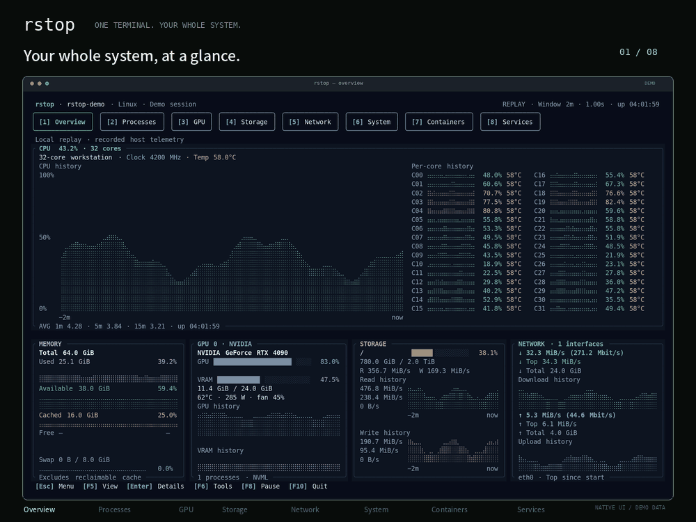

# rstop

[](https://github.com/fan-ziqi/rstop/actions/workflows/checks.yml)
[](https://github.com/fan-ziqi/rstop/releases/latest)
[](rust-toolchain.toml)
[](LICENSE)

**One terminal. Your whole system.** A Rust TUI for local CPU, GPU, processes, storage, networking, containers and services on Linux, macOS and Windows.

[Website](https://fan-ziqi.github.io/rstop/) · [Feature and platform coverage](COVERAGE.md) · [Contributing](CONTRIBUTING.md) · [Releases](RELEASING.md)

[](https://fan-ziqi.github.io/rstop/)

## Install

Linux and macOS:

```sh
curl --proto '=https' --tlsv1.2 -LsSf https://github.com/fan-ziqi/rstop/releases/latest/download/rstop-installer.sh | sh
```

Windows PowerShell:

```powershell
powershell -ExecutionPolicy Bypass -c "irm https://github.com/fan-ziqi/rstop/releases/latest/download/rstop-installer.ps1 | iex"
```

Restart the shell, then run `rstop`. Prebuilt binaries install to `~/.local/bin` under your user profile; Rust is not required. Normal monitoring checks GitHub in the background on launch and every 15 minutes, without caching results. A newer stable release opens a compact dialog with its Release link and **Upgrade** (default), **Ignore this session**, and **Skip this version**. Offline failures and up-to-date results stay silent. Read-only monitoring and replay do not check. Set `check_updates = false` to disable automatic checks.

Use `rstop update --check` to check manually, `rstop update` to install an update, or rerun the installer. Updates require an installer-managed copy. [Release archives and checksums](https://github.com/fan-ziqi/rstop/releases) are also available for manual installation.

Supported release targets: Linux x86-64/ARM64 with glibc 2.35+, macOS Intel/Apple Silicon, Windows x64/ARM64. NVIDIA monitoring uses the installed driver/NVML; the CUDA Toolkit is not required. Docker, Podman and inspection utilities are optional and are not installed automatically. See [platform limits](COVERAGE.md#known-gaps).

Use a UTF-8 true-color terminal, preferably 140×44 or larger; minimum 60×18.

## Run from source

Install Git, [Rust through rustup](https://rustup.rs/) and native build tools: `build-essential` on Ubuntu, Xcode Command Line Tools on macOS, or MSVC C++ Build Tools on Windows. Cargo uses [the pinned Rust toolchain](rust-toolchain.toml).

```sh
git clone https://github.com/fan-ziqi/rstop.git
cd rstop
cargo run --locked                         # Development build
cargo run --locked -- gpu --interval 1000   # Arguments follow --
cargo build --release --locked
./target/release/rstop                     # Optimized build
```

On Windows, run `.\target\release\rstop.exe`. For routine monitoring, use a release build or `cargo run --release --locked`.

## Use

```sh
rstop
rstop gpu --interval 1000
rstop --theme black --layout compute
rstop --read-only
rstop --no-gpu
rstop --full-sampling                      # Start every background source immediately
rstop snapshot                            # JSON snapshot
rstop sample --samples 10 > samples.jsonl
rstop record session.jsonl                 # Record while using the TUI
rstop replay session.jsonl
rstop export csv metrics.csv --samples 10
rstop export svg screen.svg --samples 30
rstop gpu select --count 1 --min-free-mib 8192
rstop network connections --filter port:443 --sort download --json
rstop doctor --input session.jsonl --view storage --json
```

`rstop --help` lists commands; each subcommand has its own `--help`. Generate a manual with `rstop man` or shell completions with `rstop completions bash` (also zsh, fish, PowerShell and Elvish).

Snapshots and recordings include process command lines. Environments are read only on request and are not recorded; logs are excluded from telemetry. Recordings rotate at 64 MiB by default, retaining the current file and three older files. Replay input is limited to 512 MiB.

## Pages

| Key | Page | Contents |
|---|---|---|
| `1` | Overview | CPU/per-core histories, frequency, load and temperature; RAM/swap, GPU/VRAM, storage I/O and network charts |
| `2` | Processes | Sorting/filtering, trees, threads, live selection histories, 90 selectable columns, files, environments and process controls |
| `3` | GPU | Device/process tables, load/VRAM/engine/power/temperature/clock/PCIe charts and supported driver, MIG, NVLink, ECC and throttle fields |
| `4` | Storage | Filesystems, throughput, IOPS, latency, queues, inodes and bounded folder scans |
| `5` | Network | Interfaces, traffic history, connections/owners/TCP rates, endpoint checks and bounded packet capture |
| `6` | System | Sensors, batteries, pressure, NUMA, IRQ, RAPL, readable SMART/RAID, local runtimes and custom probes |
| `7` | Containers | Local Docker/Podman resources, details, logs, processes, filesystem changes and lifecycle actions |
| `8` | Services | State/resources, logs, configuration, dependencies and management through systemd, launchd or Windows SCM |

All eight pages remain accessible with loading or empty-state messages when a device/runtime is absent. Unknown numbers appear as `—`. Driver, CUDA Driver API and NVML versions are shown on the GPU page; CUDA Driver API describes driver support, not the installed Toolkit.

Host and physical-GPU overview histories run from startup. Other sources activate on first use and keep updating after you leave their pages, preserving chart time axes. Connections refresh independently at one second; container/service discovery waits five seconds between scans. `--full-sampling`, recording and headless collection enable all sources immediately.

## Controls

Buttons show their keyboard shortcuts; every function is accessible from the keyboard. `?` opens the main menu, `F1` shows help, and `:` opens the complete command list.

| Keys | Action |
|---|---|
| `1`–`8`, `←/→`, `Tab/Shift+Tab` | Change page |
| `↑/↓`, `j/k`, `PgUp/PgDn`, `Home/End` | Select or scroll |
| `F3`, `f`, `/` | Edit the focused table's inline filter |
| `F4`, `s` | Sort chooser, including reverse order; `P`/`M` sort by CPU/RAM |
| `F5` | View, panel focus, chart window, zoom and display options |
| `[`, `]` | Previous GPU (`[`) or next GPU (`]`); click Prev/Next on the Overview GPU card or use `F5` |
| `Enter`, `d`, `F6` | Open detail pane; full details; contextual tools |
| `F7`, `m`, `l` | Process output/workload logs; object tools; logs |
| `,`, `.` | Seek backward/forward during replay |
| `W`, `z/Z`, `-/+` | Chart time window; zoom; decrease/increase sampling interval (also click the top `-` / `+`) |
| `F1`, `:` | Help; all commands |
| `F2`, `c`, `w` | Settings; theme; save configuration |
| `C`, `Shift+←/→` | Process columns; move the visible column window |
| `t`, `Ctrl+←/→` | Process tree; collapse/expand |
| `v`, `V`, `U` | Mark process, mark subtree, clear marks |
| `F9`, `n`, `a` | Signal, nice or affinity for the selected process |
| `Y`, `R`, `O` | Label actions; resource diagnosis/trends/alerts; extra sampled information |
| `Esc`, `Del` | Close/unselect/clear filter/open menu; clear an applied filter |
| `F10`, `q`, `Ctrl+C` | Quit and restore the terminal |

Click or scroll over a table to focus it. Network and GPU keep both tables on one page, with independent filters, sorting and scrolling. Headers sort; right-click opens tools; double-click opens details. Inactive buttons keep the surrounding background, the current page has an accent outline, and filled highlights identify selected rows.

Process selection starts empty. Click a row or press ↑/↓ to select; press Enter or double-click to open its detail pane. This also applies to connections, services and containers. Esc closes the pane before clearing selection; selecting another row closes it. Wheel scrolling moves the process viewport without changing the PID. Selection holds row order while values update; explicit sorting applies the new order. The detail pane shows CPU/RAM, attributed GPU/VRAM, I/O and histories starting at selection time. Exit, PID reuse or filtering clears selection. Scroll the pane with its mouse wheel or `Alt+↑/↓`, `Alt+PgUp/PgDn`, `Alt+Home/End`. Use `d` for full details, `F6` for tools, or `:` for all commands. The bottom action bar wraps on narrow terminals to keep resource actions visible.

Filters update in place as you type. Enter/↓ apply; Esc restores the previous query. Editors support cursor movement, Home/End, deletion and `Ctrl+A/E/U/K/W`. Examples:

```text
user:alice cpu:>10 !name:rust
name:/python|torch/
pid:42 | mem:>1024
tag:ros
port:443 !proto:udp
```

Spaces mean AND; space-delimited ` | ` means OR. Quotes, negation and numeric comparisons are supported. `mem`/`vram` use MiB; unknown values do not match zero.

`W` selects 15 seconds to one hour, subject to the 3,600-sample retention limit. Sampling speed is independent of the window. Chart titles retain units when compact layouts omit axes; memory utilization uses `%`, capacity uses `B`, and rates distinguish `B/s` from `bit/s`. Charts enter from the right, leave on the left, preserve peaks in aligned buckets and break at missing observations or long collection gaps. Startup leaves uncollected time blank; the menu reports the actual retained duration.

CPU history fills upward and downward from the center, with green near zero, yellow midway and red near 100%. The upper and lower metrics are configurable; set `display.cpu_graph_lower = "none"` to show only the upper half.

## Inspect and manage

`F6` offers tools relevant to the current resource and installed utilities. Actions preview the complete command and fixed target before `y` confirmation. Process identity includes PID/start time; Linux signals prefer pidfd. Privileges are not elevated automatically. `--read-only` and replay disable state changes; replay also disables live inspection.

Select a process, service or container and press `F7` for readable stdout/stderr files, workload logs or PID journal entries. Use `p` to select a log file. Following refreshes every three seconds; `f` resumes, `/` searches, and scrolling pauses it. File tails are bounded to 1 MiB and handle truncation/replacement. Pipes/terminals are not consumed, and unsaved terminal output cannot be recovered. [Platform-specific output support](COVERAGE.md#interaction-and-operations).

Network tools include explicit DNS/TCP/TLS/HTTP checks, routes/DNS inspection and Linux/macOS `tcpdump` capture. Capture previews its interface/filter/output and is limited by duration/packet count. New PCAP files are private and existing files are never overwritten; captured bytes can contain private data. TCP rates use native Linux socket diagnostics with a procfs/`ss` fallback and need two observations. macOS/Windows provide connection listings without byte rates.

Labels identify software, observed resources and inferred purposes (`?`). Select a row and press `Y` for evidence and related tools. Linux ROS-labelled processes offer ROS 1/2 topic/node/service browsing, info/QoS, bounded echo/hz, message definitions and parameter reads using that process's environment; ROS CLI is required. Labels do not establish application health or complete feature parity. [Recognition and limits](COVERAGE.md#workload-recognition-and-shortcuts).

## Configuration

Use `F2` for live settings and `w` to save, or `rstop config write` to write defaults. Paths:

- Linux: `$XDG_CONFIG_HOME/rstop/config.toml`, default `~/.config/rstop/config.toml`.
- macOS: `~/Library/Application Support/rstop/config.toml`.
- Windows: `%APPDATA%/rstop/config.toml`.

Override with `--config PATH`. Configuration is written only on request.

```toml
interval_ms = 1000       # 250..10000
history = 180            # 30..3600 samples per series
time_window_seconds = 180
theme = "midnight"
layout = "balanced"      # balanced / compute / storage / minimal
columns = ["pid", "user", "cpu", "memory", "vram", "gpu", "command"]

[display]
cpu_graph = "total"
temperature_unit = "celsius"
network_interface = ""   # All visible interfaces
network_bits = false
group_processes = false
```

Themes: midnight, nord, ember, black, white, graphite, ocean, forest and sand. `--ascii`/`--no-color` support restricted terminals. Custom colors, nested layouts, selected sensors, graph scales, folders, alerts and local probes are defined in [the configuration schema](src/config.rs). [Process column identifiers](src/fields.rs).

Selected extended process fields enable their collectors; expensive reads cache for five seconds. TASKSTATS requires kernel support and existing permissions. Configured probes/alert commands are opt-in argument arrays without a shell; `--no-config-exec` and read-only mode disable them. rstop does not start a web server or connect to remote monitoring/container services.

## License

[Apache-2.0](LICENSE). Dependency licenses are included in release archives as `THIRD-PARTY-LICENSES.html`. Behavioral references include btop, nvitop, htop, nvtop, bottom and Glances; [pinned revisions, licenses and scope](COVERAGE.md#reference-projects).
